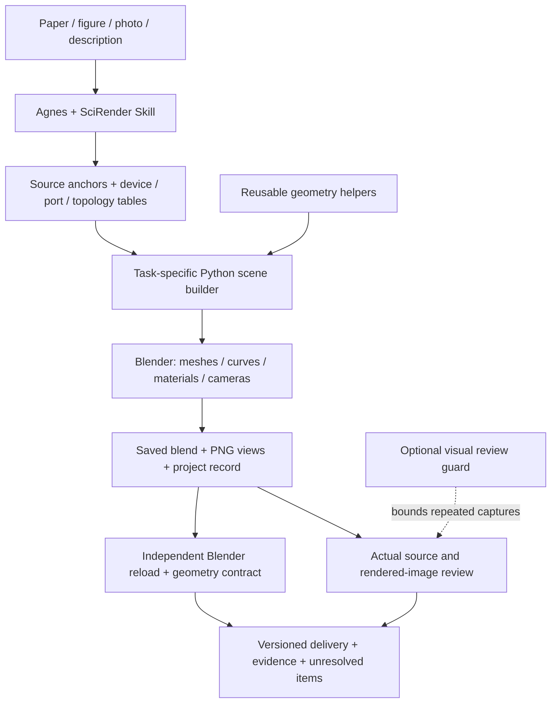

# SciRender · Editable 3D scientific equipment from research sources

**English** | [简体中文](README.zh-CN.md)

An Agnes Harness Skill that turns research figures, photographs and descriptions into editable Blender scenes, with traceable sources, explicit connection topology and separate geometry and image reviews.

[Demo video](#demo-video) · [Quick start](#quick-start) · [Architecture](#architecture) · [Integration standards](#integration-standards) · [Results](results/2026-10-15/README.md)

## Project overview

Scientific equipment is often documented across figures, captions and methods. Reconstructing it for a paper discussion or presentation requires recognizable devices, clear assembly relationships and visible connections. The result should remain editable as the equipment or presentation changes.

**SciRender (研境)** organizes this process into a reusable Skill for [Agnes Harness](https://github.com/AgnesAI-Labs/agnes-harness). Agnes coordinates source reading and task execution; Python and Blender implement the scene. The current standalone Skill is **v1.1.1**, and its installation does not require the case archive.

### Core features and innovations

- **Source-grounded modeling:** record source anchors, device identities, visible features, assumptions and unknowns before modeling. Unsupported details remain schematic or unknown.
- **Connections with ownership:** define ports, media, directions and routes before building cables, tubes and optical paths. A line touching a housing does not establish a valid connection.
- **Editable delivery:** preserve objects, materials, cameras and modeling scripts; render overviews and details from the same geometry, with optional editable SVG labels.
- **Separate geometry and image review:** reopen the saved scene in an independent Blender process for declared geometry checks, then inspect actual images for appearance and readability.
- **Reusable acceptance contracts:** a shared runner verifies frozen auditor hashes, expected check IDs, scene hashes, counts and process completion. Case-specific audits define coverage.
- **Bounded visual review:** an optional Agnes plugin persists review state, limits repeated screenshots and supports resuming unfinished work from checkpoints.

SciRender supports paper interpretation, group meetings, teaching and research planning. Outputs are illustrative reconstructions; they do not establish exact dimensions, manufacturing suitability, sealing, flow, mechanical performance or equipment safety. Recorded examples involve human direction and AI-assisted repairs; they are not an autonomous blind benchmark.

## Demo video

[Watch / download demo video](https://github.com/Hanratty211/agh-scientific-equipment-renderer/releases/download/demo-20261028/scirender-demo.mp4)

### Delivered examples

| Example | Editable output | Recorded geometry checks | Image review |
| --- | --- | --- | --- |
| Microfluidic external sampling setup | v11 scene and four views | 141/141 + 5/5 support checks | Accepted by the user |
| Robotic material gripping setup | v08 scene and four views | 32/32 + 10/10 revision checks | Accepted after user review |


Five syringes share a rack, with five blue inlet routes and five green outlet reservoirs. One of the six external port pairs remains unused. [Editable scene](results/2026-10-15/microfluidics/scene.blend) · [Evidence and sources](results/2026-10-15/README.md)


Upper and lower circular grips, a continuous two-color specimen and the support frame remain editable. [v08 scene](results/2026-10-15/robotics-v08/scene.blend) · [Revision comparison](results/2026-10-15/robotics-v08/README.md) · [Human acceptance](results/2026-10-15/HUMAN_REVIEW.md)

## Quick start

### Environment

| Component | Requirement / recorded environment |
| --- | --- |
| Blender | **5.1.2** was used for published cases; other versions require verification |
| Python | Python 3 for CLI helpers; the acceptance runner uses only the standard library |
| Optional Python packages | PyYAML for package structure checks; Pillow for image utilities |
| Agnes Harness | Required for the interactive Skill workflow; configure the model provider in your own installation |
| Node.js | Only for the optional review plugin; follow your Agnes checkout's requirement |
| Platform | Recorded local validation on macOS; Windows/Linux have not been validated here |

```bash
git clone https://github.com/Hanratty211/agh-scientific-equipment-renderer.git
cd agh-scientific-equipment-renderer
python3 -m venv .venv
. .venv/bin/activate
python3 -m pip install PyYAML Pillow
export AGH_BLENDER="/Applications/Blender.app/Contents/MacOS/Blender"
```

The activation and executable path above are macOS/Linux shell examples. On Windows, activate `.venv\Scripts\Activate.ps1` and set `$env:AGH_BLENDER` to your Blender executable. Configure model credentials in local Agnes settings; no model key is needed to inspect scenes or run standalone acceptance tools.

### Run the Skill

1. Start your configured [Agnes installation](https://github.com/AgnesAI-Labs/agnes-harness/blob/main/docs/guide/install.md).
2. Import the **whole `agh-scientific-equipment-renderer/` directory** as a local source through Agnes's managed Skill flow. Resolve same-name conflicts and updates through the host's supported management flow.
3. Read the installed Skill with `skill_read` and verify the version/revision. The historical `skills/` path is not the canonical package.
4. Supply the source material, target panel, relevant captions/methods and required scope. For example:

   > Use agh-scientific-equipment-renderer to reconstruct the external sampling assembly in Fig. 3C. Preserve five input/output routes. Deliver an editable .blend, overview/detail PNGs and source/assumption records. Mark hidden paths and unsupported dimensions as unknown. Reopen the saved scene for geometry checks and review the actual PNGs separately.

5. Follow the Skill's source/device/port/topology tables, modeling, saved-scene checks and image review. Keep failed versions and unresolved items in the project directory.

The Skill provides instructions and reusable helpers. Scene builders are written for each task; the package does not offer a one-command paper-to-CAD conversion. [Package installation and tests](agh-scientific-equipment-renderer/README.md)

### Recheck an existing result without Agnes

From the repository root, after setting `AGH_BLENDER`:

```bash
python3 tools/acceptance/accept_case.py \
  results/2026-10-15/microfluidics/scene.blend rerun/microfluidics \
  --contract results/2026-10-15/microfluidics/contract.json
```

Expected coverage: **141 checks**. Use a fresh output directory for each run; the runner refuses to overwrite evidence. Results are saved as `gate.json`, `geometry.json` and `execution.log`. Support checks, robotics v08 checks and re-render commands are in [REPRODUCE.md](results/2026-10-15/REPRODUCE.md) (Chinese).

```bash
python3 -m unittest discover -s tools/acceptance -p 'test_*.py' -v
python3 agh-scientific-equipment-renderer/scripts/test_v11_workflow.py
python3 -B agh-scientific-equipment-renderer/scripts/check_structure.py
node integrations/agnes-visual-guard/test.mjs
```

The structure check invokes real Blender synthetic tests. Passing these tests establishes tool behavior within their scope, not scientific or visual acceptance.

## Architecture



| Module | Implementation and responsibility |
| --- | --- |
| [Skill package](agh-scientific-equipment-renderer/SKILL.md) | Routing, source interpretation, identity/port gates, progressive modeling and review checkpoints |
| [Geometry helpers](agh-scientific-equipment-renderer/scripts/blender_core.py) | Reusable Blender Python helpers; tasks may also use their own builders |
| [Record validator](agh-scientific-equipment-renderer/scripts/validate_project_record.py) | JSON consistency, required scope, references, media and dependency records |
| [Saved-scene auditor](agh-scientific-equipment-renderer/scripts/audit_saved_scene.py) | Supported, explicitly declared geometry checks against the saved scene |
| [Acceptance runner](tools/acceptance/README.md) | Independent process, frozen coverage/hash checks, timeouts and preserved reports |
| [Optional review plugin](integrations/agnes-visual-guard/README.md) | Public Agnes hooks with opt-in, persistent capture limits |
| [Published results](results/2026-10-15/README.md) | Editable scenes, render scripts, contracts, checksums and review evidence |

Blender meshes and Boolean operations represent devices, apertures and cavities. Curves represent visible tubes and cables; world-space transforms locate ports and routes. Cameras render the assembly and details from the same geometry. Source interpretation, geometry checks and image judgments remain separately recorded.

## Integration standards

SciRender integrates through a **managed Skill, local CLI/files and an optional Agnes plugin**. It does not expose a hosted HTTP API. These JSON contracts are project formats, not industry certification standards.

| Interface | Contract and integration method |
| --- | --- |
| Skill discovery | `SKILL.md` with YAML frontmatter (`name`, `description`), bundled references/scripts; import the full canonical directory and verify `skill_read` |
| Task inputs | Source URL/DOI or authorized local material, target figure/panel, scope and outputs; keep facts, assumptions and unknowns separate |
| Project record | JSON `schema: "agh-equipment/0.6"`; top-level `task`, `components`, `ports`, `connections`, `supports`; stable IDs bind records to Blender objects |
| Port/route semantics | Ports declare `owner`, `medium`, `direction`, `state`; connections reference endpoint IDs. Explicit tolerances use Blender world units; physical-unit interpretation requires a verified scene scale |
| Static validation | `validate_project_record.py RECORD --report REPORT`; exit `0` = PASS, `2` = FAIL, `3` = UNKNOWN, `1` = invalid input/schema |
| Case acceptance | `accept_case.py SCENE NEW_OUTPUT_DIR --contract CONTRACT [--blender PATH] [--timeout SECONDS]`; contract records `case_id`, `audit_script`, `audit_sha256`, `expected_check_ids`, `scope` |
| Acceptance result | `gate.json` reports PASS/FAIL, reasons, hashes, exit code and coverage; geometry reports include check IDs/statuses/counts and scene path/hash. Missing coverage or unsuccessful execution fails the gate |
| Artifacts | `.blend`, PNG, Python builders/renderers, JSON records/reports, Markdown evidence and optional SVG labels; published checksums use SHA-256 |
| Visual guard | ESM plugin `@scirender/visual-review-guard` v0.1.1; `registerHook` for `tool_call`, `tool_result`, `before_step`; workspace marker `{"run_id":"my-review-001"}` opts in |

The guard limits the supported `computer_use capture` path to three attempts per target, three identical image digests and twelve attempts overall. A 180-second budget is enforced at subsequent call/step boundaries. State persists under `.scirender-review-state/`; exhausted runs block with `NEEDS_EXTERNAL_REVIEW`. The guard does not interrupt in-flight tools or constrain other tools.

For another agent host, supply file access, command execution, Blender and actual image inspection, then follow the same records and reviews. Host compatibility must be checked; no MCP server or cross-host certification is included. [Record specification](agh-scientific-equipment-renderer/references/project_record.md) · [Acceptance tools](tools/acceptance/README.md) · [Plugin installation](integrations/agnes-visual-guard/README.md)

## License, attribution and repository hygiene

Original code, Skill instructions and documentation are licensed under [MIT](LICENSE). Third-party papers, figures, photographs, audio and other assets retain their own licenses. Generated scenes/renders are outside this blanket code/documentation grant. See [third-party notices and asset scope](THIRD_PARTY_NOTICES.md), including demo credits and historical archive limitations.

Keep model keys, passwords, private material and local session state outside commits. Local `.env` files and runtime review state are ignored. [Submission checks](docs/SUBMISSION_CHECKLIST.md) record the inspection scope and limitations.

[Repository map](docs/REPOSITORY_MAP.md) · [Version provenance](agh-scientific-equipment-renderer/PROVENANCE.md) · [Historical archive](docs/history/README.md) · [Same-model visual comparison](results/2026-10-15/visual-comparison/README.md)
