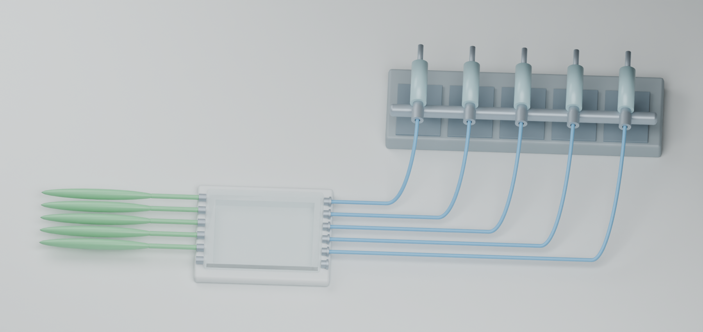

# SciRender · 让科研装置从论文走进可编辑三维场景

**基于 Agnes 的科研装置重建 Skill：把来源识别、器件建模、端口连接、几何验收和图片复核串成可追溯的工作流程。**

面向论文解读、组会展示和科研方案沟通，交付可编辑的 Blender 场景与多视角图片。当前独立 Skill 为 **v1.1.1**，不依赖仓库中的案例素材即可安装。

[安装与使用](agh-scientific-equipment-renderer/README.md) · [最新成果与复核](results/2026-10-15/README.md) · [仓库地图](docs/REPOSITORY_MAP.md)

## 从“画出来”到“能检查、能修改、能复用”

- **来源驱动建模**：先确定器件身份、接口和逐线连接关系，再生成场景，让关键结构有据可查。
- **可编辑交付**：保留对象、材质、相机与场景文件；支持继续改结构、换视角和制作展示图。
- **双层验收**：独立重开保存场景检查几何，再实际读取渲染图片，分别核对结构和可读性。
- **跨案例复用**：共享验收执行器，按领域配置检查契约；覆盖数量、场景哈希和进程退出均纳入判定。
- **有界视觉复核**：可选 Agnes 插件保存复核状态，控制重复截图次数与步骤时间预算。

## 已交付案例

|案例|可编辑成果|独立几何检查|图片复核|
|---|---|---|---|
|微流控外部采样装置|v11 场景、4 个视角|141/141 + 5/5 支承检查通过|用户接受|
|机器人材料夹持装置|v08 场景、4 个视角|32/32 + 10/10 补充检查通过|用户复核接受|

### 微流控：五路连接清晰呈现

五支注射器共架，连接五路蓝色输入管、芯片外口和五路绿色输出气囊；六对外口中保留一对闲置。查看 [可编辑场景](results/2026-10-15/microfluidics/scene.blend) 与 [验收说明](results/2026-10-15/README.md)。

### 机器人材料夹持：结构与局部同时可查

上下圆形夹具、连续两色试样和支承框架完整呈现，另提供正视及上下夹具局部图。[下载可编辑场景](results/2026-10-15/robotics-v08/scene.blend)。

以上是来源约束下的科研示意验收，适用于解释与展示；未作为制造、密封、流动或力学性能验证。实现包含 AI 辅助工程修复，执行与审阅分工见[成果记录](results/2026-10-15/README.md)。

## 快速开始

1. 将 `agh-scientific-equipment-renderer/` 整个目录作为本地来源，通过 Agnes 受管 Skill 导入流程安装。
2. 提供论文图、目标子图和需要展示的范围，请 Agnes 调用 `agh-scientific-equipment-renderer`。
3. 按 Skill 完成来源与端口表、建模、保存、重载检查及原生图片复核。
4. 交付 `.blend`、多视图 PNG 和简明验收结论。

已有成果可直接在 Blender 5.1.2 中打开；独立检查无需运行 Agnes。详见[复核命令](results/2026-10-15/REPRODUCE.md)。

用户已接受微流控 v11 和机器人 v08。[用户图像验收](results/2026-10-15/HUMAN_REVIEW.md) · [机器人修改前后对照](results/2026-10-15/robotics-v08/README.md)。

## 验证与工程资料

- [同一 Agnes 模型的图片对照](results/2026-10-15/visual-comparison/README.md)：纯提示词与调用 Skill 的原始输出、固定渲染条件和匿名评审结果。
- [共享验收工具](tools/acceptance/README.md)：冻结检查集合、校验脚本与场景哈希，保留每次独立输出。
- [Agnes 视觉复核插件](integrations/agnes-visual-guard/README.md)：按会话选择启用，状态可恢复。
- [Skill 版本与来源](agh-scientific-equipment-renderer/PROVENANCE.md)：源码、安装与运行时读取分别记录。
- [历史材料导航](docs/REPOSITORY_MAP.md)：保留既有案例路径和版本历史；详细本地调试记录不重复发布。
