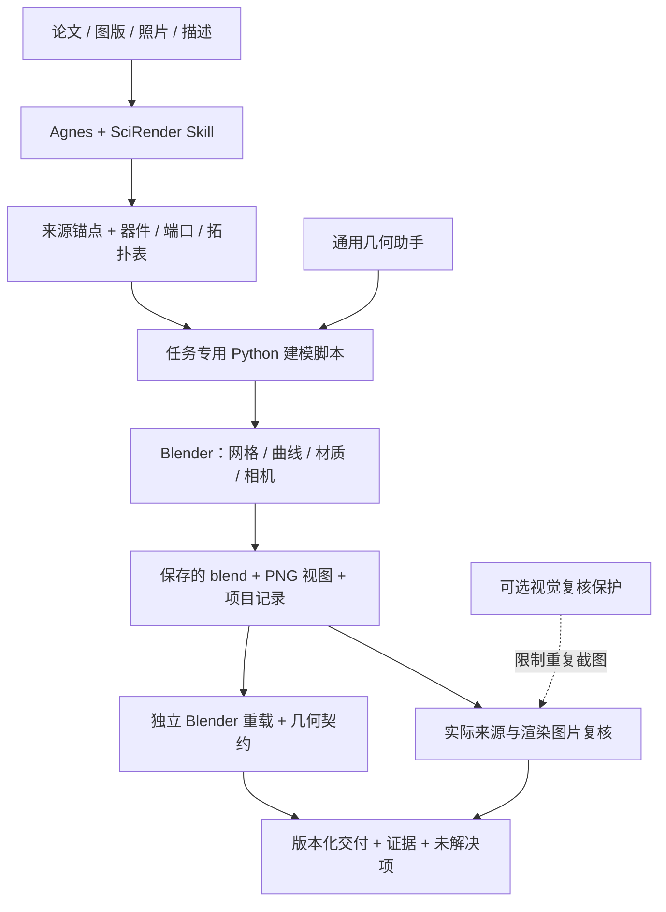

# 研境 SciRender · 让科研装置从论文走进可编辑三维场景

[English](README.md) | **简体中文**

基于 Agnes Harness 的科研装置重建 Skill：把论文图、实验照片与结构描述转为可编辑 Blender 场景，将来源记录、连接拓扑、几何检查和图片复核串成可追溯的工作流程。

[演示视频](#演示视频) · [快速开始](#快速开始) · [架构介绍](#架构介绍) · [集成标准](#集成标准) · [成果记录](results/2026-10-15/README.md)

## 项目介绍

科研装置的信息往往分散在图版、图注和方法中。为论文解读或汇报重建装置，需要识别器件、交代装配关系并呈现可见连接；后续更换设备或调整讲解角度时，素材也应能继续编辑。

**研境 SciRender** 将这一流程组织为 [Agnes Harness](https://github.com/AgnesAI-Labs/agnes-harness) 可调用的专用 Skill。Agnes 负责材料阅读和任务组织，Python 与 Blender 负责构建、编辑和渲染场景。当前独立 Skill 为 **v1.1.1**，安装不依赖案例档案。

### 核心功能与创新亮点

- **来源驱动建模**：建模前记录来源锚点、器件身份、可见特征、假设和未知项；无依据细节明确标为示意或未知。
- **连接归属明确**：先描述端口所属部件、介质、方向与路径，再构建线缆、管路和光路；线端接触机壳不能直接视为连接正确。
- **可编辑交付**：保留 Blender 对象、材质、相机和建模脚本；从同一套几何输出总览、局部 PNG，可选生成可编辑 SVG 标注。
- **几何与图像分开验收**：独立重开保存场景，核查已声明的几何关系；再实际读取渲染图片，检查外观与可读性。
- **验收契约跨案例复用**：共享执行器校验冻结审计脚本哈希、检查 ID、场景哈希、计数和进程完成状态，由案例审计脚本定义覆盖范围。
- **有界视觉复核**：可选 Agnes 插件持久化复核状态，限制重复截图，并支持从检查点继续处理未完成项。

研境适用于论文解读、组会、教学与科研方案沟通。成果属于示意性重建，不证明精确尺寸、制造适用性、密封、流动、力学性能或设备安全。现有案例包含人工指定目标和 AI 辅助工程修复，不属于自主盲测基准。

## 演示视频

[观看 / 下载演示视频](https://github.com/Hanratty211/agh-scientific-equipment-renderer/releases/download/demo-20261028/scirender-demo.mp4)

### 已交付案例

| 案例 | 可编辑成果 | 已记录的几何检查 | 图片复核 |
| --- | --- | --- | --- |
| 微流控外部采样装置 | v11 场景、4 个视角 | 141/141 + 5/5 支承检查通过 | 用户接受 |
| 机器人材料夹持装置 | v08 场景、4 个视角 | 32/32 + 10/10 补充检查通过 | 用户再次复核接受 |


五支注射器共架，连接五路蓝色输入管和五路绿色输出储液囊；六对外口中保留一对闲置。[可编辑场景](results/2026-10-15/microfluidics/scene.blend) · [验收与来源记录](results/2026-10-15/README.md)


上下圆形夹具、连续两色试样和支承框架均保留为可编辑几何。[v08 场景](results/2026-10-15/robotics-v08/scene.blend) · [修改前后对照](results/2026-10-15/robotics-v08/README.md) · [用户图像验收](results/2026-10-15/HUMAN_REVIEW.md)

## 快速开始

### 环境配置

| 组件 | 要求 / 已记录环境 |
| --- | --- |
| Blender | 已发布案例使用 **5.1.2**；其他版本需另行验证 |
| Python | CLI 辅助脚本使用 Python 3；共享验收执行器仅依赖标准库 |
| 可选 Python 依赖 | PyYAML 用于包结构检查；Pillow 用于图像辅助工具 |
| Agnes Harness | 交互式 Skill 流程需要；模型提供方在个人 Agnes 环境中配置 |
| Node.js | 仅可选复核插件需要；版本遵循使用的 Agnes 源码要求 |
| 平台 | 已记录 macOS 本地验证；Windows/Linux 尚未在本项目验证 |

```bash
git clone https://github.com/Hanratty211/agh-scientific-equipment-renderer.git
cd agh-scientific-equipment-renderer
python3 -m venv .venv
. .venv/bin/activate
python3 -m pip install PyYAML Pillow
export AGH_BLENDER="/Applications/Blender.app/Contents/MacOS/Blender"
```

以上激活与路径配置为 macOS/Linux shell 示例。Windows 使用 `.venv\Scripts\Activate.ps1` 激活，并将 `$env:AGH_BLENDER` 设为实际 Blender 可执行文件路径。模型凭据在本地 Agnes 设置中配置；打开场景或运行独立验收工具无需模型 Key。

### 调用 Skill

1. 启动已配置的 [Agnes 环境](https://github.com/AgnesAI-Labs/agnes-harness/blob/main/docs/guide/install.md)。
2. 将 **`agh-scientific-equipment-renderer/` 整个目录**作为本地来源，通过 Agnes 受管 Skill 流程导入。同名冲突或更新使用宿主支持的管理流程处理。
3. 用 `skill_read` 读取已安装 Skill，核对版本和 revision。历史 `skills/` 路径不是规范安装源。
4. 提供来源材料、目标子图、相关图注/方法和重建范围，例如：

   > 调用 agh-scientific-equipment-renderer，重建 Fig. 3C 的外部采样组件，保留五路输入/输出关系。交付可编辑 .blend、总览/局部 PNG 与来源/假设记录。隐藏路径和无依据尺寸标为未知。独立重开保存场景检查几何，再单独实际复核 PNG。

5. 按 Skill 完成来源、器件、端口和拓扑表，建模、保存场景检查及图像复核；在项目目录保留失败版本与未解决事项。

Skill 提供流程与通用助手，案例生成脚本按任务编写，不提供一条命令把任意论文自动转为精密 CAD 的承诺。[独立包安装与测试](agh-scientific-equipment-renderer/README.md)

### 不依赖 Agnes 复核已有成果

设置 `AGH_BLENDER` 后，在仓库根目录执行：

```bash
python3 tools/acceptance/accept_case.py \
  results/2026-10-15/microfluidics/scene.blend rerun/microfluidics \
  --contract results/2026-10-15/microfluidics/contract.json
```

预期覆盖 **141 项检查**。每次使用新的输出目录；执行器拒绝覆盖已有证据。结果保存在 `gate.json`、`geometry.json` 和 `execution.log`。支承补充检查、机器人 v08 检查及重新渲染命令见 [REPRODUCE.md](results/2026-10-15/REPRODUCE.md)。

```bash
python3 -m unittest discover -s tools/acceptance -p 'test_*.py' -v
python3 agh-scientific-equipment-renderer/scripts/test_v11_workflow.py
python3 -B agh-scientific-equipment-renderer/scripts/check_structure.py
node integrations/agnes-visual-guard/test.mjs
```

结构检查会调用真实 Blender 合成测试。这些测试通过只说明对应工具行为符合测试范围，不等于科学或视觉验收通过。

## 架构介绍



| 模块 | 实现方式与职责 |
| --- | --- |
| [Skill 包](agh-scientific-equipment-renderer/SKILL.md) | 路由、来源理解、身份/端口门槛、渐进建模与复核检查点 |
| [通用几何助手](agh-scientific-equipment-renderer/scripts/blender_core.py) | 可复用 Blender Python 几何方法，也允许任务使用自写建模器 |
| [项目记录校验器](agh-scientific-equipment-renderer/scripts/validate_project_record.py) | JSON 一致性、原始必需范围、引用关系、介质与依赖记录 |
| [保存场景审计器](agh-scientific-equipment-renderer/scripts/audit_saved_scene.py) | 对保存场景检查工具支持且已明确声明的几何关系 |
| [共享验收执行器](tools/acceptance/README.md) | 独立进程、冻结覆盖/哈希检查、超时与报告留存 |
| [可选复核插件](integrations/agnes-visual-guard/README.md) | 基于 Agnes 公开 hook，按会话启用并持久化截图限制 |
| [成果目录](results/2026-10-15/README.md) | 可编辑场景、渲染脚本、验收契约、校验和与复核证据 |

Blender 网格和布尔运算构建设备、孔口与空腔；曲线表达可见管线，世界坐标变换定位端口与路径；相机从同一套几何输出完整装置和局部图。来源解释、几何检查与图像判断分别记录。

## 集成标准

研境通过**受管 Skill、本地 CLI/文件及可选 Agnes 插件**集成，不提供托管 HTTP API。下列 JSON 契约属于项目格式，不代表行业认证标准。

| 接口 | 规范与集成方式 |
| --- | --- |
| Skill 发现 | `SKILL.md` 含 YAML frontmatter（`name`、`description`），随包提供参考与脚本；整体导入规范目录，再以 `skill_read` 核对 |
| 任务输入 | 来源 URL/DOI 或有授权的本地材料、目标图版/子图、重建范围与交付需求；事实、假设和未知项分开记录 |
| 项目记录 | JSON `schema: "agh-equipment/0.6"`；顶层为 `task`、`components`、`ports`、`connections`、`supports`；稳定 ID 绑定 Blender 对象 |
| 端口/路径语义 | 端口声明 `owner`、`medium`、`direction`、`state`；连接引用两端 ID。显式容差使用 Blender 世界单位，物理单位换算需另核场景尺度 |
| 静态校验 | `validate_project_record.py RECORD --report REPORT`；退出码 `0` = PASS、`2` = FAIL、`3` = UNKNOWN、`1` = 输入/格式无效 |
| 案例验收 | `accept_case.py SCENE NEW_OUTPUT_DIR --contract CONTRACT [--blender PATH] [--timeout SECONDS]`；契约记录 `case_id`、`audit_script`、`audit_sha256`、`expected_check_ids`、`scope` |
| 验收结果 | `gate.json` 返回 PASS/FAIL、原因、哈希、退出码与覆盖数量；几何报告含检查 ID/状态/计数及场景路径/哈希；漏项或进程异常无法通过 |
| 输出文件 | `.blend`、PNG、Python 建模/渲染脚本、JSON 记录/报告、Markdown 证据，可选 SVG 标注；发布文件使用 SHA-256 校验 |
| 视觉保护插件 | ESM 插件 `@scirender/visual-review-guard` v0.1.1，使用 `registerHook` 的 `tool_call`、`tool_result`、`before_step`；工作区标记 `{"run_id":"my-review-001"}` 启用 |

保护插件对支持的 `computer_use capture` 路径限制同一目标最多 3 次、相同图像 digest 出现 3 次后停止、总共最多 12 次；180 秒预算在后续调用/步骤边界执行。状态写入 `.scirender-review-state/`，触发后以 `NEEDS_EXTERNAL_REVIEW` 阻断；不会中断正在执行的工具，也不约束其他工具。

接入其他智能体宿主时，需要文件访问、命令执行、Blender 和实际读图能力，并沿用相同记录与复核流程；需自行核对宿主兼容性。本仓库未提供 MCP 服务或跨宿主认证。[项目记录规范](agh-scientific-equipment-renderer/references/project_record.md) · [共享验收工具](tools/acceptance/README.md) · [插件安装](integrations/agnes-visual-guard/README.md)

## 许可、署名与仓库清理

原创代码、Skill 方法与文档采用 [MIT](LICENSE) 许可证。论文、图版、照片、音频等第三方素材仍遵循各自许可；生成场景和渲染图也不纳入这项统一代码/文档授权。具体范围见[第三方来源与素材说明](THIRD_PARTY_NOTICES.md)，含视频署名及历史档案限制。

模型 Key、密码、私人材料与本地会话状态应保留在提交之外。仓库忽略本地 `.env` 文件和复核运行状态。[提交检查记录](docs/SUBMISSION_CHECKLIST.md)注明检查范围及限制。

[仓库地图](docs/REPOSITORY_MAP.md) · [版本来源](agh-scientific-equipment-renderer/PROVENANCE.md) · [历史档案](docs/history/README.md) · [同模型图片对照](results/2026-10-15/visual-comparison/README.md)
