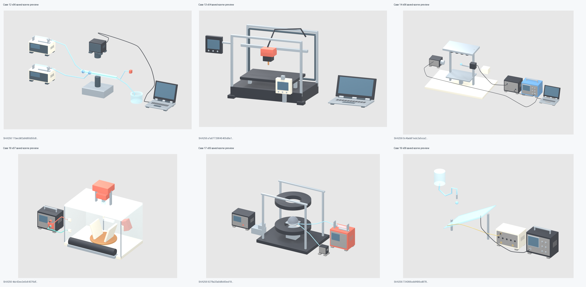

# 六例实物与接口修订 R4 — GitHub 交付

日期：2026-10-12。Skill 保持 v0.7。本次补齐此前仅保存在本地的最终 PNG 与可编辑 Blender 场景。

状态：代表性低成本实物预览阶段收口。实际图片审查独立于 AGH 几何核查；未验证厂家 CAD/尺寸精度、隐藏线路、密封、电气安全或功能。

## 可编辑场景与图片

| 案例 | 版本 | 场景 | 图片 |
|---|---|---|---|
| 12 | v06 | [.blend](cases/12_capillary_microfluidics/scene_v06.blend) | [overview](cases/12_capillary_microfluidics/overview_v06_reloaded_r4.png) · [camera_data_rear](cases/12_capillary_microfluidics/detail_camera_data_rear_v06_reloaded_r4.png) |
| 13 | v04 | [.blend](cases/13_fff_printer/scene_v04.blend) | [overview](cases/13_fff_printer/overview_v04_reloaded_r2.png) · [laptop_mechanical_hinge](cases/13_fff_printer/detail_laptop_mechanical_hinge_v04_reloaded_r2.png) |
| 14 | v06 | [.blend](cases/14_acoustic_levitation/scene_v06.blend) | [overview](cases/14_acoustic_levitation/overview_v06_reloaded_r2.png) · [amp_output_scope_analog_input](cases/14_acoustic_levitation/detail_amp_output_scope_analog_input_v06_reloaded_r2.png) · [scope_bnc_mating_boot](cases/14_acoustic_levitation/detail_scope_bnc_mating_boot_v06_reloaded_r2.png) · [laptop_real_data_aperture](cases/14_acoustic_levitation/detail_laptop_real_data_aperture_v06_reloaded_r2.png) |
| 16 | v07 | [.blend](cases/16_electrospinning/scene_v07.blend) | [overview](cases/16_electrospinning/overview_v07_reloaded_r4.png) · [both_insulated_entries](cases/16_electrospinning/detail_both_insulated_entries_v07_reloaded_r4.png) |
| 17 | v05 | [.blend](cases/17_magnetic_shell/scene_v05.blend) | [overview](cases/17_magnetic_shell/overview_v05_reloaded_r2.png) · [pump_barrel_action_end](cases/17_magnetic_shell/detail_pump_barrel_action_end_v05_reloaded_r2.png) · [pump_tube_and_sample_interface](cases/17_magnetic_shell/detail_pump_tube_and_sample_interface_v05_reloaded_r2.png) |
| 19 | v06 | [.blend](cases/19_triboelectric_glass/scene_v06.blend) | [overview](cases/19_triboelectric_glass/overview_v06_reloaded_r2.png) · [analog_bnc_mating_boot](cases/19_triboelectric_glass/detail_analog_bnc_mating_boot_v06_reloaded_r2.png) · [resistor_terminal_and_boot](cases/19_triboelectric_glass/detail_resistor_terminal_and_boot_v06_reloaded_r2.png) |

## 依据与复用

- [独立实际读图记录](codex-review/physical_r4_actual_pixel_review.json)
- [AGH R4 执行检查点](PHYSICAL_FEEDBACK_R4_AGH_CHECKPOINT.md)
- [可移植文件路径与 SHA-256 清单](GITHUB_DELIVERY_R4_MANIFEST.json)
- [Skill v0.7](../skills/agh-scientific-equipment-renderer/SKILL.md)

直接用 Blender 打开表内 .blend 即可编辑。构建与核查脚本已纳入 Git 历史；部分增量构建脚本依赖历史 .blend，本次媒体交付只包含上述最终场景，不保证仅凭这些最终文件可从第一版完整重建。旧版与失败稿继续保留在本地。

原 physical_feedback_r4_manifest.json 是生成时的历史快照，其 PENDING 字段已由后续独立读图记录及检查点补充；不要将其理解为最终视觉结论。
