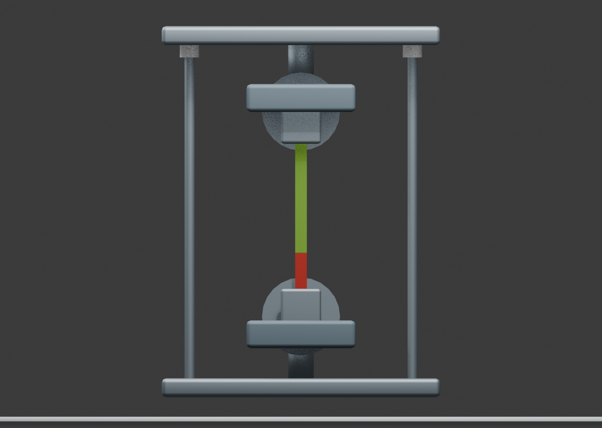
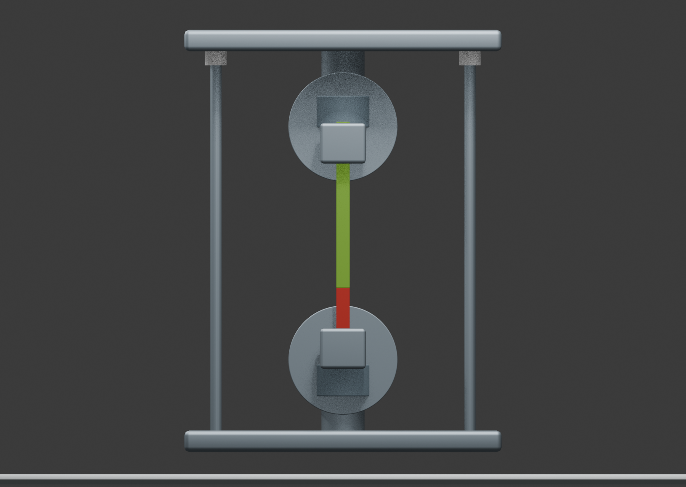
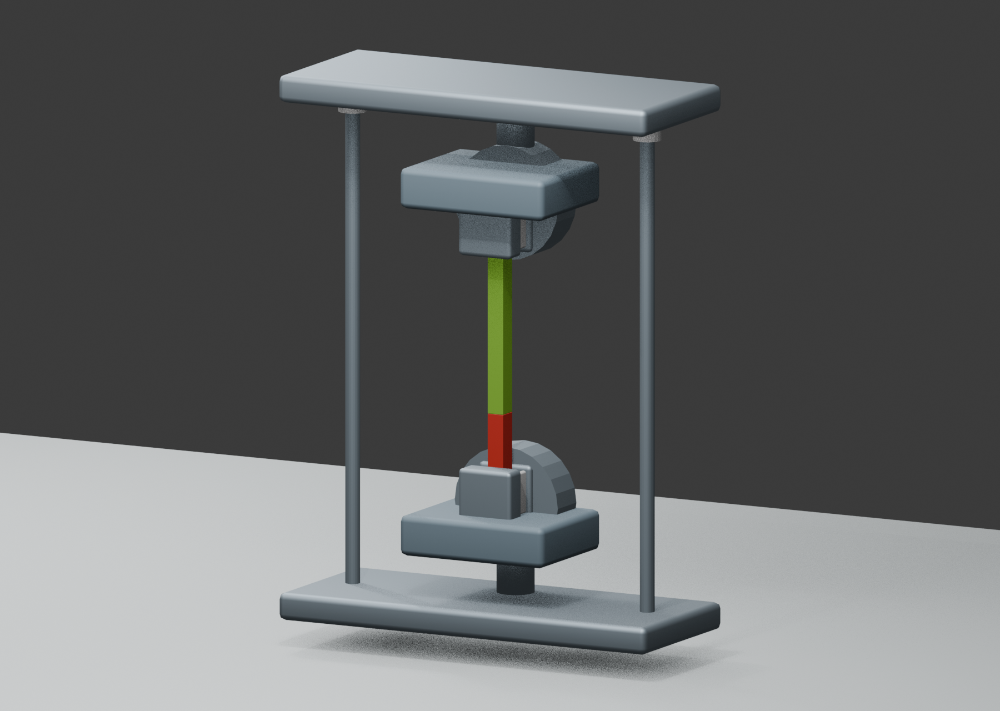
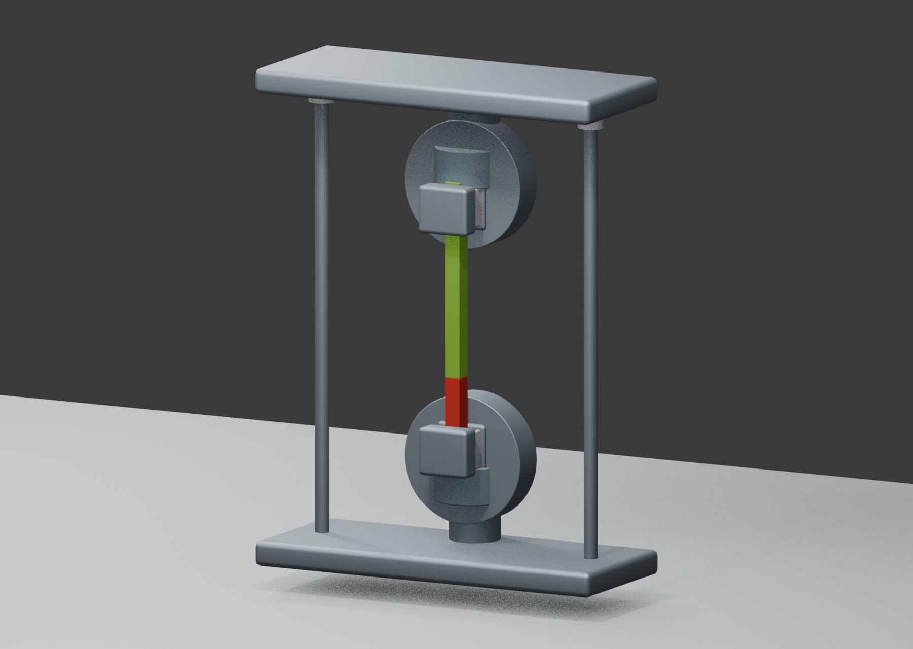
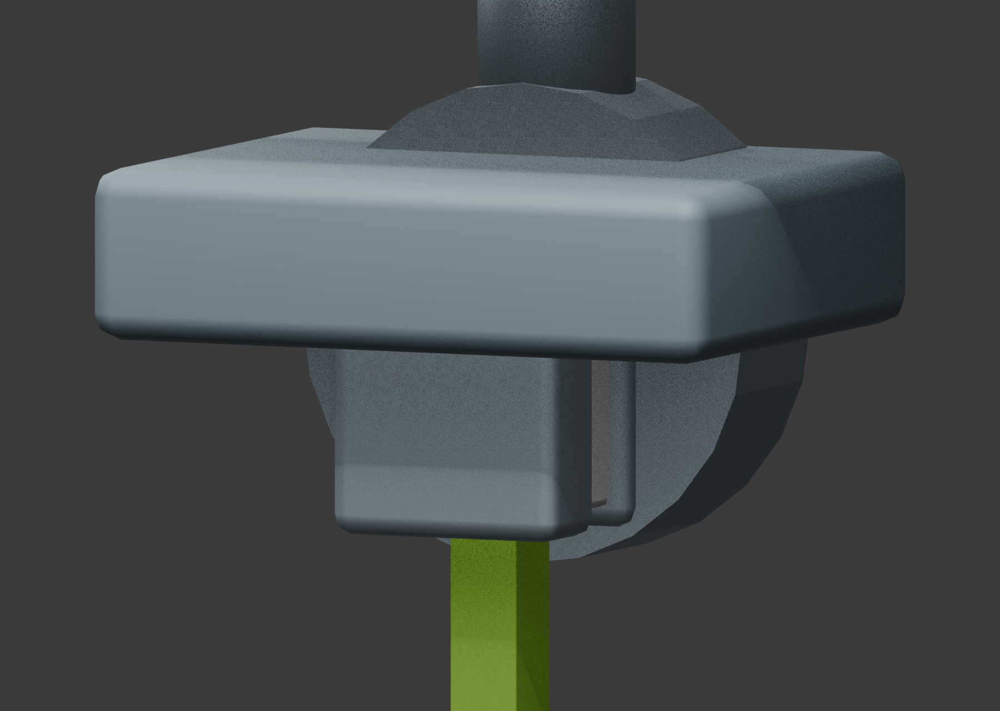
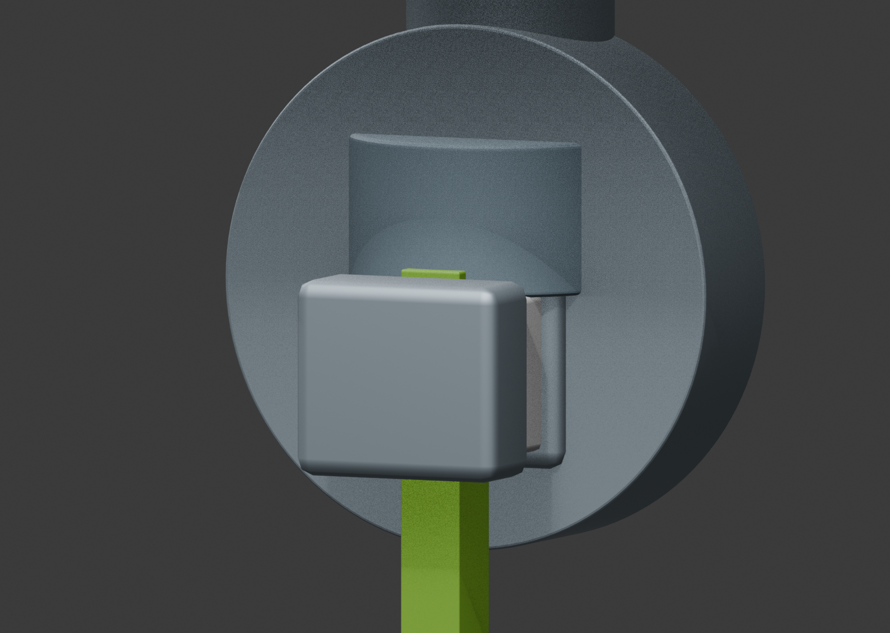
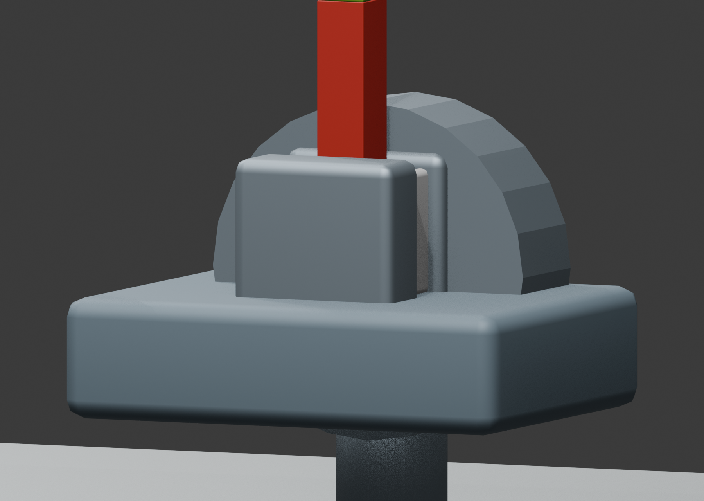
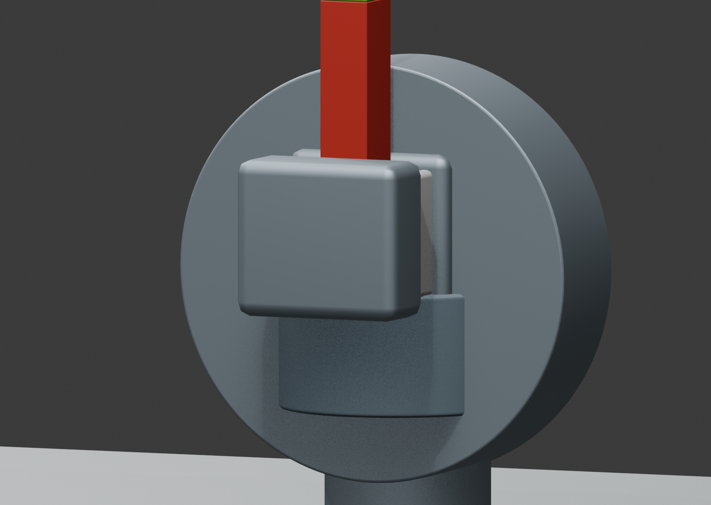

# 机器人夹持 v08：按用户意见修复并验收

用户在 v07 中接受器件身份与可见夹持关系，但指出“上下之前悬空的支撑结构有点小。原文是圆形这里全是矩形的”。v08 完成局部修复后，用户对圆形外观与比例、上下支撑大小均选择“符合”，最终选择“接受”。[结构化人工验收](../human-acceptance.json)。

- 两个圆形夹具体半径从 0.35 增至 0.43；宽矩形托座改为半径 0.24 的圆柱托座；支撑轴半径从 0.115 增至 0.17。
- 数值为场景图示单位下的比例调整，不是来源论文提供的实物尺寸。仅六个网格对象改变，试样、夹爪、框架、灯光与相机保持。
- 原冻结装配契约 **32/32 通过**；补充截面、尺寸和未改动对象检查 **10/10 通过**。四个视图复用原渲染脚本，实际检查了总览、正视和上下夹具局部。
- 本次修复由 AI 助手根据用户意见完成，未调用 Agnes；本次人工验收不等同于 Agnes 自主新任务测试。

[可编辑 v08 场景](scene.blend) · [原始 v07 场景](../robotics/scene.blend) · [复核命令](../REPRODUCE.md) · [补充检查结果](shape-checks.json)

|视角|修改前 v07|修改后 v08|
|---|---|---|
|正视|||
|总览|||
|上夹具|||
|下夹具|||

点击图片查看原始分辨率。论文来源为 DOI 10.1038/s41467-025-56025-3、Fig. 3b，来源图继续保留在本地对照页，不随此更新发布。

## 验证过程

补充检查脚本曾因空射线结果触发 TypeError；增加空结果失败处理后记录为 8 PASS / 2 FAIL。世界坐标 BVH 在上夹具负 X 方向的径向边界漏中一个采样，改用对象局部坐标 BVH 与变换后的射线后，同 24 个采样角和同阈值达到 10 PASS / 0 FAIL。未改变场景或放宽阈值。另有场景清单缺少来源 authority、交付契约缺少 required_paths 的初次失败，补全元数据后通过。原失败脚本、日志与输入均保留在本地。

这是科研示意的几何与图像验收，不是夹紧力、强度或制造验证。工程检查和用户接受分别记录。
