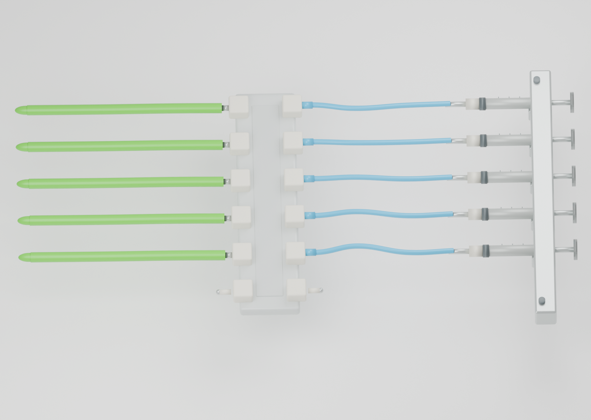
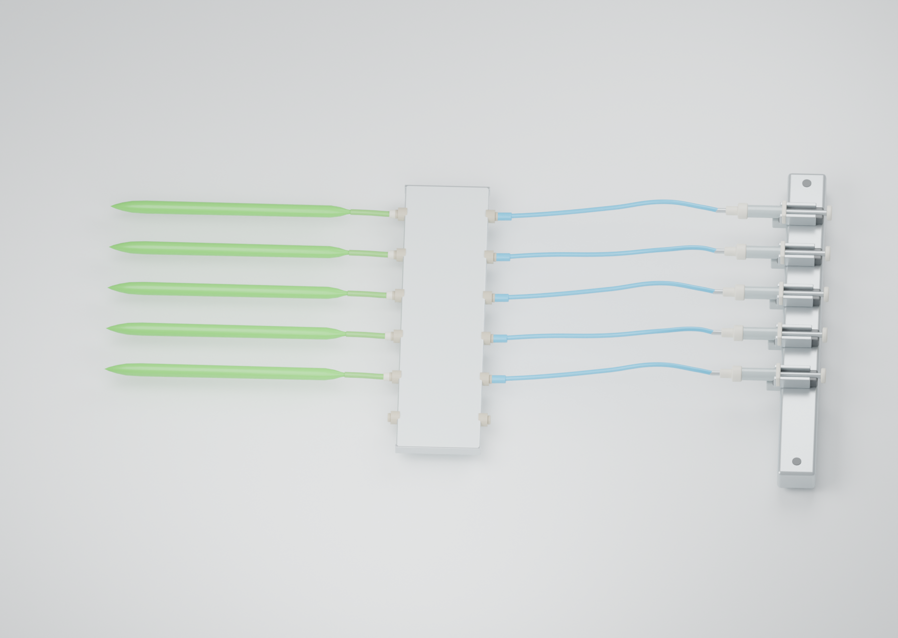

# 同一 Agnes 模型：纯提示词与调用 Skill 的图片对照

两组均使用 Agnes / gpt-6-sol、同一模型路由与 standard 配置、相同来源图和基础任务，从空场景开始。纯提示词组实际读取 Skill **0 次**；Skill 组实际读取 v1.1.1 **1 次**。候选设计由各自 Agnes 会话生成，AI 助手没有替两组修改候选模型。

|纯提示词|调用 Skill|
|---|---|
|||
|[可编辑场景](baseline/scene.blend)|[可编辑场景](skill/scene.blend)|

|匿名模型评审维度|满分|纯提示词 A|Skill B|
|---|---:|---:|---:|
|来源身份与完整范围|25|23|23|
|可见连接与接口|30|27|26|
|支撑及装配合理性|20|17|16|
|相对比例与材质外观|15|13|12|
|可读性和构图|10|9|8|
|合计|100|89|85|

评审在新会话中只收到来源图和匿名 A/B 图，映射在送审前确定、评审后揭盲。两张图均完成主要组件及五路外部连接；**这一个配对样本未观察到 Skill 的视觉优势**。此表是探索性图片评分，不是比赛六维作品总分，也不是人类评审或统计显著性结论。

每组预算为初建 900 秒、原生图片反馈 300 秒，最多一次视觉修改。两组最终均为 Cycles CPU、64 samples、seed 7、denoise、1800×1280；模型采样种子未受控。独立重开最终场景渲染，均与交付 PNG 的解码 RGB 像素完全一致。

执行中存在权限适配及路径错误：首次基线未产图，后以相同输入在新会话重试；Skill 组在同会话恢复自身提出的修复，扣除已用初建时间。实际完成顺序为 Skill → 基线重试，故不据此比较速度或 token 效率。原失败、预算与干预记录完整留在本地。评审还将内部不可确认写入不足栏，因此四分差距仅保留为该评审的探索性结果，不作客观量尺。

来源为 [Fig. 3C](https://doi.org/10.1038/s41526-025-00470-3)，论文原图不随包发布。[复核命令](../REPRODUCE.md) · [结构化摘要](../evidence-summary.json)

## 后续用户判断

用户在已知分组条件下判断：Skill 在完整性、连接接口、外形比例和整体使用偏好四项更好，支撑装配与清晰度构图两项相当。该单人结果与上面的匿名模型评分并列保留，不合并成新分数，不推断统计显著性。详见[人工验收](../HUMAN_REVIEW.md)。
